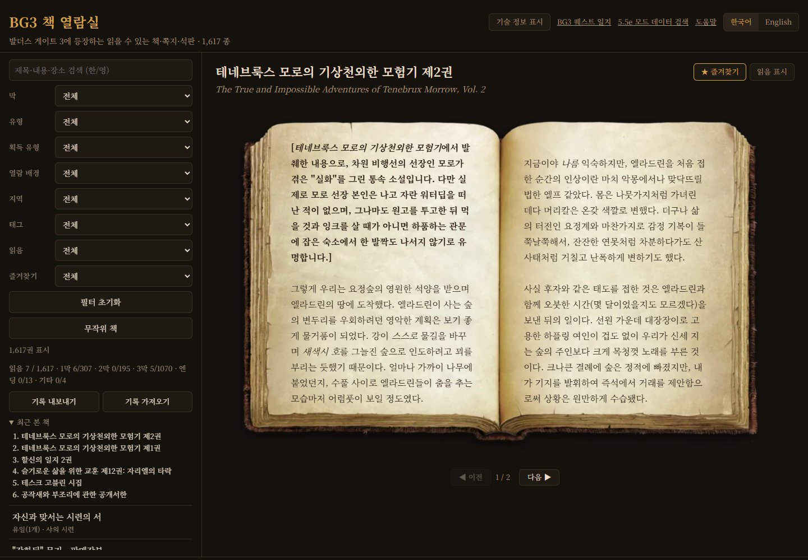
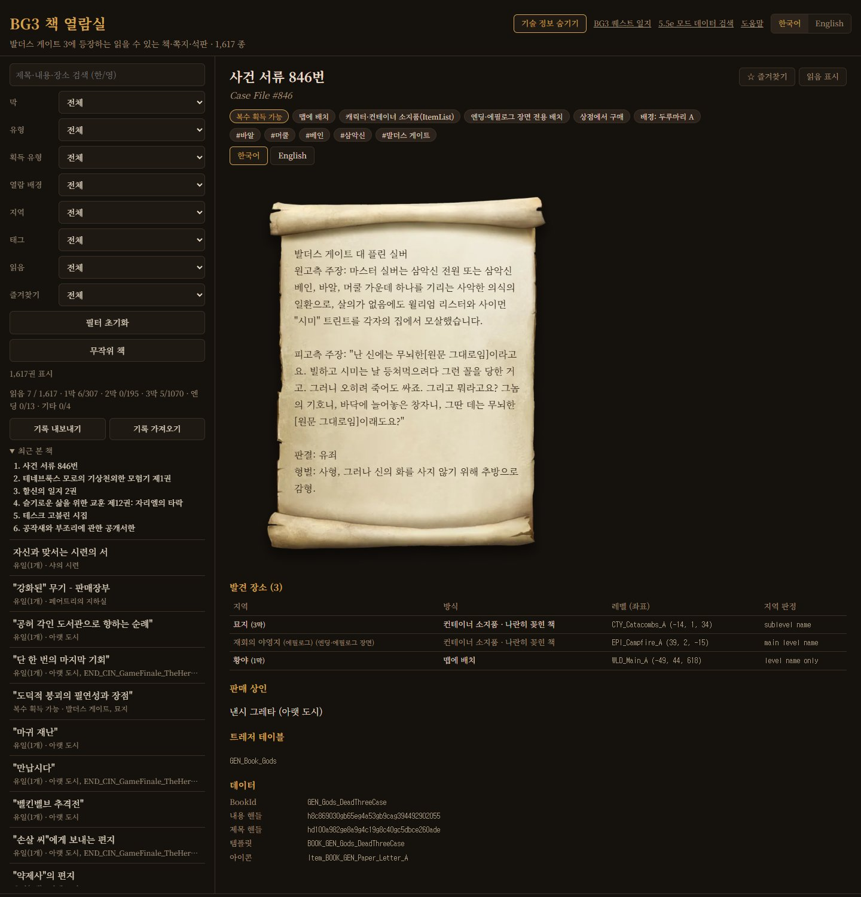

# BG3 책 열람실

[English](README.md)

발더스 게이트 3 바닐라 데이터에서 읽을 수 있는 책·쪽지·석판을 모두 모아 발견 장소와 함께 조회하고, 읽은 책을 기록하는 사이트입니다.

- 사이트: https://yoonmoonsik.github.io/bg3book/

## 읽기

- 1,617종을 게임 속 열람 배경(책, 종이 한 장, 종이 묶음, 두루마리, 석판, 기스양키 원판) 위에 보여 줍니다.
- 책은 두 쪽 펼침으로 열립니다. 버튼, 좌우 방향키, 마우스 휠, 터치 화면 스와이프로 쪽을 넘깁니다. 두루마리·석판·원판은 스크롤합니다.
- 제목·내용·장소를 한국어나 영어로 검색합니다. 검색어를 강조하고 첫 검색어가 있는 쪽을 엽니다.
- 막, 유형, 획득 유형, 열람 배경, 지역, 태그, 읽음, 즐겨찾기로 거릅니다. 책의 칩을 누르면 그 필터가 걸립니다.
- 시리즈는 몇 권째인지와 다른 권 링크를 보여 줍니다.
- 책 본문을 한국어·영어로 바꿔 읽습니다. 화면도 한국어·영어를 지원합니다.
- **무작위 책**은 현재 목록에서 한 권을 엽니다.

## 발견 장소

- 맵 배치: 지역, 막, 발견 방식(맵에 배치, 상자 안, 캐릭터 소지), 좌표.
- 판매 상인, 책을 주는 스토리 스크립트(Osiris), 스토리 진행 중 획득, 트레저 테이블.
- BookId, 내용·제목 핸들, 템플릿, 아이콘.
- 모두 기술 정보로, 켜기 전까지 숨겨 둡니다. 숨김 모드에서는 제목과 본문만 보입니다.

## 읽음 기록

- 책을 **읽음**과 **즐겨찾기**로 표시합니다. 목록에 ✓와 ★가 붙습니다.
- 읽음 진행률: 전체와 막별.
- **최근 본 책**: 마지막으로 연 책 10권.
- 읽음·즐겨찾기 기록을 JSON으로 내보내고 다른 브라우저에서 가져옵니다. 가져오면 기존 기록에 더해집니다.
- 기록은 브라우저 `localStorage`에만 저장됩니다.

## 키보드 단축키

| 키 | 동작 |
|---|---|
| ← / → | 쪽 넘기기 |
| ↑ / ↓ | 목록의 이전 / 다음 책 (스크롤되는 글은 끝까지 스크롤한 뒤) |
| R | 보고 있는 책 읽음 표시·해제 |
| F | 보고 있는 책 즐겨찾기·해제 |
| T | 기술 정보 표시·숨김 |
| E / K | 책 본문 영어 / 한국어 (한국어 화면) |

## 데이터

- `books.csv` / `books.json`: 제목·내용 핸들, 열람 배경, 발견 장소, 상점, 트레저 테이블, Osiris 지급, 추론 태그
- `build_books.py`: 언팩한 게임 데이터에서 위 파일과 `docs/data/books.json`을 다시 만듭니다.
