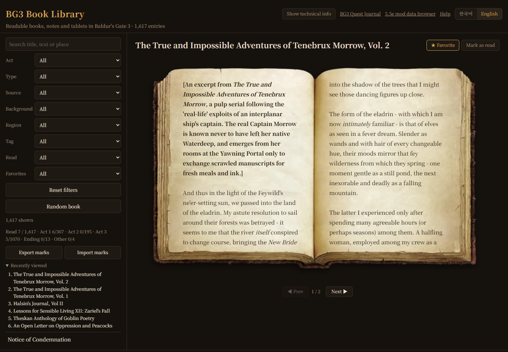
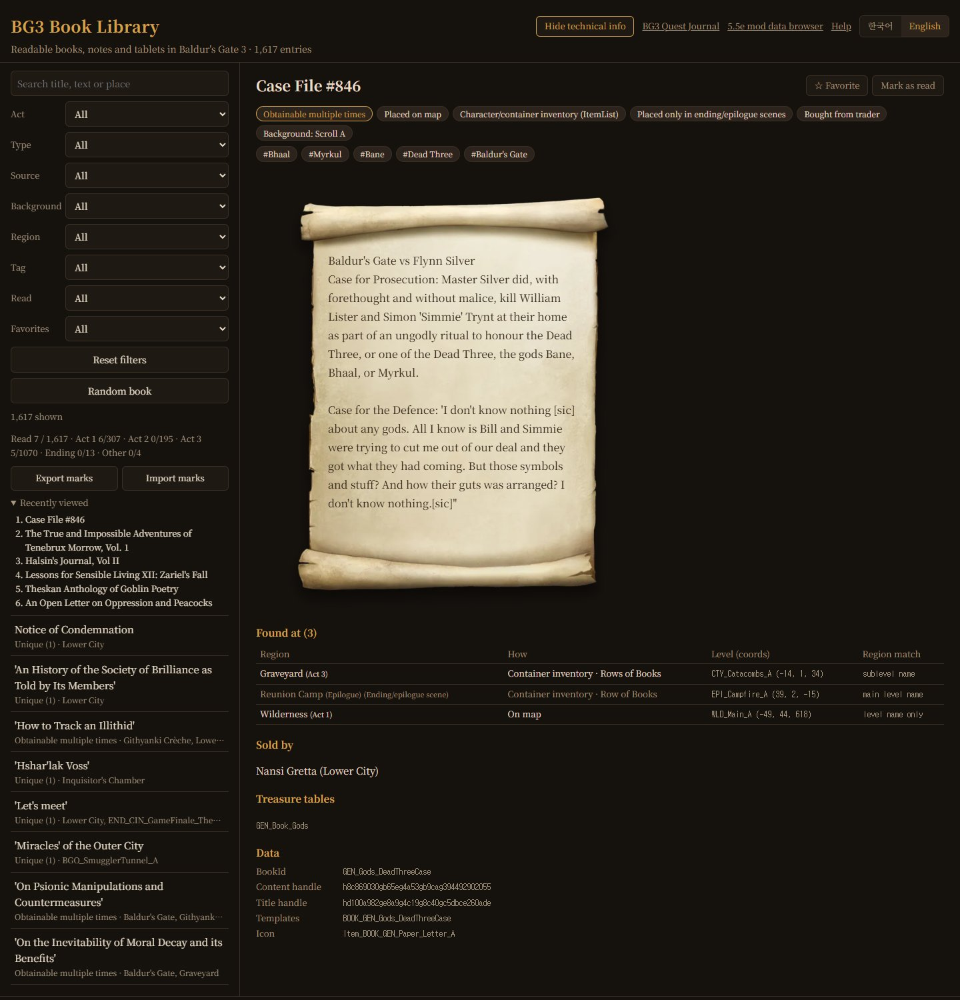

# BG3 Book Library

[한국어](README.ko.md)

A website for reading every readable book, note and tablet in vanilla Baldur's Gate 3, with where to find each one, and for tracking what you have read.

- Site: https://yoonmoonsik.github.io/bg3book/

## Read

- 1,617 entries, each shown on its in-game background: book, paper sheet, paper stack, scroll, tablet or Githyanki disc.
- Books open as a two-page spread; turn pages with the buttons, the arrow keys, the mouse wheel or a swipe on touch screens. Scrolls, tablets and discs scroll.
- Search titles, text and places in Korean or English; matches are highlighted and the page holding the first one opens.
- Filter by act, type, source, background, region, tag, read and favorites. Clicking a chip on a book applies that filter.
- Series show their volume number with links to the other volumes.
- Read the book text in Korean or English; the interface comes in Korean and English too.
- **Random book** opens a book from the current list.

## Where to find

- Map placements with region, act and how the book is found (on the map, in a container, carried by a character), plus coordinates.
- Traders who sell it, story scripts (Osiris) that give it, books picked up during the story, and treasure tables.
- BookId, content and title handles, templates and icon.
- All of this is technical info, hidden until you turn it on; hidden mode shows only the title and the book.

## Track your reading

- Mark books **read** and **favorite**; the list shows ✓ and ★.
- Read progress: total and per act.
- **Recently viewed**: the last 10 books you opened.
- Export your read and favorite marks as JSON and import them on another browser; an import adds to the marks already there.
- Marks are saved only in your browser (`localStorage`).

## Keyboard shortcuts

| Key | Action |
|---|---|
| ← / → | Turn the page |
| ↑ / ↓ | Previous / next book in the list (a scrolling page scrolls to its end first) |
| R | Mark the current book read / unread |
| F | Favorite / unfavorite the current book |
| T | Show / hide technical info |
| E / K | Book text in English / Korean (Korean interface) |

## Data

- `books.csv` / `books.json`: title and content handles, background, placements, traders, treasure tables, Osiris grants and inferred tags.
- `build_books.py` rebuilds these files and `docs/data/books.json` from the unpacked game data.
